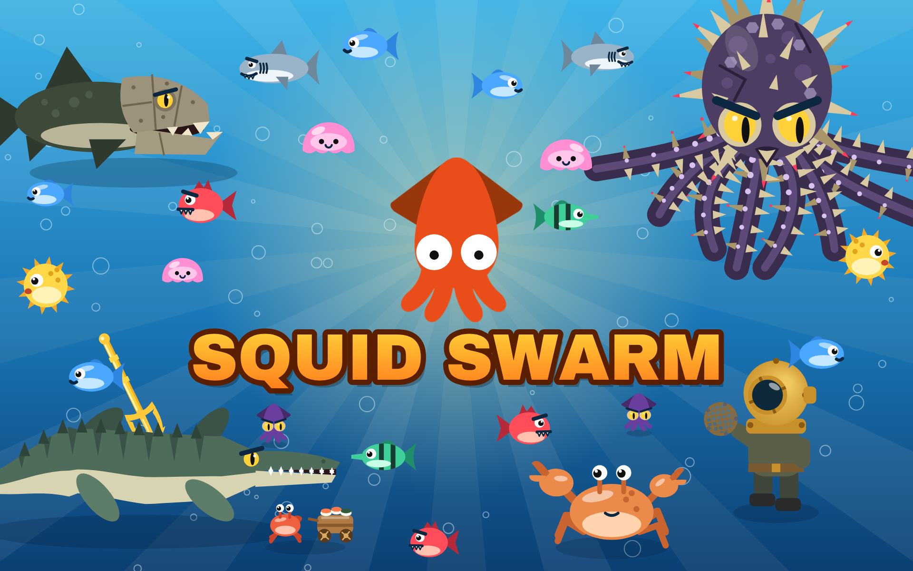

# 🦑 SquidSwarm

Un survival roguelike a ondate da giocare sul telefono (stile Megabonk / Vampire Survivors).
Sei un calamaro arancione: sopravvivi a ondate di pesci sempre più numerose, potenzia le tue armi e sconfiggi i boss preistorici fino al Kraken.

**▶ Gioca:** apri `index.html` nel browser, oppure attiva GitHub Pages (vedi sotto) e gioca dal link.

## Come si gioca
- **Telefono:** trascina il dito per nuotare. Le armi sparano da sole.
- **Computer:** WASD o frecce.
- Elimina tutti i pesci per passare all'ondata successiva.
- A ogni livello scegli un potenziamento; i potenziamenti non hanno limite di livello.

## Contenuti
- **7 armi** con evoluzioni: Getto d'inchiostro, Bolle, Rete, Mine, Onda sonar, Anguilla elettrica, Tridente
- **Mini boss:** Granchio della sabbia (ondata 5), Palombaro (ondata 18)
- **Boss:** Dunkleosteo (10), Mosasauro (20), Kraken (30), con cutscene e musica metalcore
- **4 scenari:** fondale sabbioso, barriera corallina, relitto, abisso
- **Modalità infinita** dopo il Kraken
- **Meta-progressione:** sushi da spendere nel negozio, livello del calamaro che sblocca i potenziamenti, skin e calamari sbloccabili

## Pubblicarlo con GitHub Pages
1. Nel repository vai su **Settings → Pages**.
2. In **Source** scegli **Deploy from a branch**, branch `main`, cartella `/ (root)`, poi **Save**.
3. Dopo un minuto il gioco è online su `https://<tuo-utente>.github.io/<nome-repo>/`.
4. Dal telefono apri il link e usa **Aggiungi a schermata Home**: avrà l'icona del gioco.

## File
| File | Cosa contiene |
|---|---|
| `index.html` | Tutto il gioco in un unico file (grafica, musica e logica) |
| `icon.png` | Icona dell'app (1024×1024) |
| `logo.png` | Logo del gioco |
